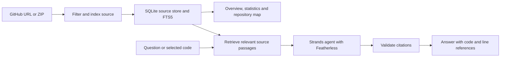

# CodeCompass

**Understand an unfamiliar repository. Find where to make your first change.**

CodeCompass helps new contributors explore a project, locate relevant code, and ask questions with answers linked to actual files and line numbers.

Built for the hackathon problem statement **“Helping New Contributors Find the Right Code.”**

## What you can do

- **Import a repository** from a public GitHub URL or a source ZIP. GitHub imports retain the commit used for analysis.
- **Understand the project** through an AI summary, visible component cards, language breakdowns, and clickable code statistics.
- **Explore its structure** with an interactive, color-coded folder and file map. Expand folders or select a file to read its source.
- **Find relevant code** using local keyword, file-path, and symbol search across multiple languages.
- **Ask follow-up questions** in a persistent chat, with inline source snippets and citations for model findings.
- **Explain selected code** directly from Source explorer. Highlight text or select line numbers, then choose **Explain code** to open chat with that exact source context.

## Quick start

### Requirements

- Python 3.11 or newer
- A Featherless API key and access to a model that supports tool calling
- Node.js 22 or newer only if you want to run the repository-map tests

### Install and run

```sh
python3 -m venv .venv
.venv/bin/pip install -r requirements.txt
cp .env.example .env
```

Set `FEATHERLESS_API_KEY` in `.env`. Keep your existing `.env` if you already have one.

```sh
.venv/bin/uvicorn app.main:app --host 127.0.0.1 --port 8000
```

Open **[http://127.0.0.1:8000](http://127.0.0.1:8000)**. Interactive API documentation is available at **[/docs](http://127.0.0.1:8000/docs)**.

The frontend is served by FastAPI; there is no separate frontend install or build step. On Windows, use `.venv\Scripts\python.exe` and `.venv\Scripts\pip.exe`; start the server with `.venv\Scripts\python.exe -m uvicorn app.main:app --host 127.0.0.1 --port 8000`.

### Configuration

| Variable | Default | Purpose |
| --- | --- | --- |
| `FEATHERLESS_API_KEY` | Required for AI features | Featherless authentication |
| `FEATHERLESS_BASE_URL` | `https://api.featherless.ai/v1` | OpenAI-compatible provider endpoint |
| `FEATHERLESS_AGENT_MODEL` | `Qwen/Qwen3-Coder-30B-A3B-Instruct` | Model used for overview and chat |
| `MAX_ARCHIVE_MB` | `20` | Maximum compressed ZIP size in MiB |
| `MAX_SOURCE_KB` | `256` | Maximum individual source-file size in KiB |
| `MAX_SOURCE_FILES` | `1000` | Maximum number of eligible files |

Indexing, keyword search, the repository map, and source browsing work without an API key. Summaries and explanations require Featherless.

## Try it

1. Import a public GitHub repository or upload a ZIP.
2. Read the project summary and statistics, explore the repository map, and inspect its components.
3. Ask a question such as “Where are incoming requests handled?” or “Which files should I read first?”
4. Inspect the cited code, then ask a follow-up about the same behavior.
5. Open a file in Source explorer, select a few lines, and click **Explain code**.

Click a line number to select a line; Shift-click another to select a range. In chat, **Enter** sends and **Shift+Enter** adds a newline. Drag any chat-panel edge or corner to resize it.

## How it works



Source files are indexed as overlapping passages. SQLite FTS5 ranks lexical matches, with weights for paths and symbols. A Strands exploration agent uses Featherless through its OpenAI-compatible endpoint, with `list_files`, `search_code`, and `read_code` tools to inspect code and gather context. It receives selected passages rather than the entire repository.

The application assigns evidence IDs and checks model citations against retrieved source. File paths, snippets, and line numbers come from the index. Successful chat turns are stored locally, and recent conversation context supports follow-up questions. Invalid response formats receive one automatic repair attempt.

### Project layout

```text
app/
  main.py                    FastAPI entry point and frontend hosting
  routers/explorer.py        Import, search, overview and conversation API
  services/source_store.py   ZIP/GitHub ingestion, SQLite storage and retrieval
  services/explorer_agent.py Featherless exploration and answer validation
  services/code_insights.py  Code statistics and component discovery
  static/                    Browser interface, source viewer and repository map
  db/                        Database support for the original APIs
tests/                      Backend and repository-map tests
evaluation/                 Ten-question retrieval benchmark
```

The browser uses `/api/explorer`. Earlier Python-specific API modules remain available for compatibility. The current explorer stores its repository snapshot and conversation in `data/explorer.db`.

## Validation

```sh
.venv/bin/pip install -r requirements-dev.txt
.venv/bin/python -m pytest -q
node --test tests/test_folder_map.mjs
.venv/bin/python evaluation/run.py
```

Backend tests cover ingestion, exclusions, multilingual retrieval, citation validation, conversation context, provider-format recovery, and selected-source explanations. Map tests cover folder expansion, layout, file nodes, and language colors. Automated tests do not make live Featherless requests.

The evaluation uses ten repository-specific questions with source-reviewed expected files and symbols in [evaluation/questions.json](evaluation/questions.json). It reports whether the expected file appears among the top five retrieved passages and writes a local `evaluation/results.json`. This measures retrieval performance on the included questions, not AI answer correctness. Evaluation uses a temporary database and preserves your active repository.

## Scope

- UTF-8 source indexing and retrieval support multiple languages. Function and type counts are pattern-based estimates and may miss unsupported syntax.
- The map represents indexed folders and files, not runtime dependencies. Component descriptions and AI explanations may be incomplete; inspect their source references.
- Common dependency directories, generated outputs, hidden files, binaries, and oversized files are excluded. The expanded archive limit is 100 MiB.
- Only a bounded selection of source is sent to Featherless. Indexing every eligible file does not mean the model has read every file.
- This is a single-user local prototype. A successful import replaces the active repository and its conversation; a failed import preserves them. GitHub imports support public repositories and are subject to API rate limits.

## License

[MIT](LICENSE). Bundled IBM Plex fonts use the [SIL Open Font License](app/static/fonts/OFL.txt).
