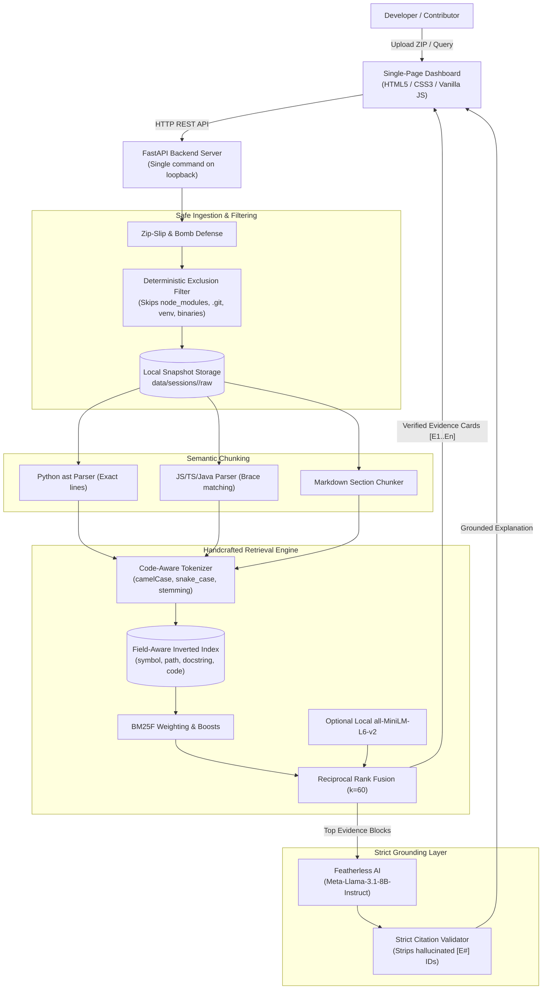

# 🚀 CBIT Hacktoberfest '26 — Project Starter Repository

> **Official Public Starter Repository for CBIT Hacktoberfest '26**  
> *Chaitanya Bharathi Institute of Technology (CBIT), Hyderabad*

---

## 📋 Team Information

| Attribute | Details |
| :--- | :--- |
| **Team Name** | **NextGen** |
| **Team Number** | `TEAM-55` (`HFT26-TEAM-55`) |
| **Registration ID** | `HFEST26-NZGJ44JQ` |
| **Problem Track** | **Track Selection in Progress** |
| **Domain** | `General Track` |
| **Team Leader** | Jasmitha reddy (25wh1a05z5@bvrithyderabad.edu.in) |
| **Institution** | Bvrith |

### 👥 Team Members

| # | Name | Email | Institution |
| :--- | :--- | :--- | :--- |
| 1 | Manasvi singh | 25wh1a05z6@bvrithyderabad.edu.in | Bvrith |
| 2 | Brahmani tatini | 25wh1a05z4@bvrithyderabad.edu.in | Bvrith |
| 3 | Rashika Singh | 25wh1a05aw@bvrithyderabad.edu.in | Bvrith |

---

## 🎯 Problem Statement

### **Track Selection in Progress**
*Domain:* **General Track**

Details regarding the chosen problem statement track and technical requirements.

---

## 🛠️ Contribution & Submission Workflow

All teams must follow the official fork-and-pull-request workflow:

1. **Fork this Repository**:
   - One team member should click the **Fork** button at the top right to fork this upstream repository to your personal/team GitHub account.
2. **Add Collaborators**:
   - In your forked repository, navigate to **Settings > Collaborators** and invite all your registered team members.
3. **Clone & Develop Locally**:
   ```bash
   git clone https://github.com/<your-username>/HFT26-TEAM-55.git
   cd HFT26-TEAM-55
   git checkout -b feature/prototype
   ```
4. **Commit & Push Regularly**:
   - Make atomic, descriptive commits throughout the hackathon.
   ```bash
   git add .
   git commit -m "feat: implement core solution architecture"
   git push origin feature/prototype
   ```
5. **Open Pull Request (PR) for Final Submission**:
   - When ready for evaluation, open a **Pull Request** from your fork's `main` branch back to this upstream repository's `main` branch.
   - **PR Title Format**: `[SUBMISSION] TEAM-55 - NextGen - Track Selection in Progress`
   - **PR Description Checklist**:
     - 📌 Solution Overview & Approach
     - 🏗️ Architecture & Tech Stack Details
     - 🚀 Local Setup & Installation Instructions
     - 🎥 Demo Video Link / Live Deployment URL
     - 📸 Key Screenshots & Visuals

---

## 📁 Recommended Project Structure

```
.
├── src/                  # Source code (Frontend / Backend / ML)
├── docs/                 # Documentation, architecture diagrams, slides
├── tests/                # Test suites & verification scripts
├── README.md             # Your project documentation & presentation
└── LICENSE               # Open-source license (MIT recommended)
```

---

## ⚠️ Important Rules & Code of Conduct
* **Upstream Protection**: Do not push directly to this repository's main branch. All evaluation will be conducted on your submitted Pull Request.
* **Original Work**: All code submitted must be developed during the hackathon timeline. Open-source libraries and frameworks are welcomed with proper attribution.
* **Code Freeze**: Final Pull Requests must be submitted before the designated hackathon submission deadline.


---

# ⚡ NextGen Code Explorer — Submission Details

> **Team Name**: NextGen (`TEAM-55`)  
> **Project Title**: NextGen Code Explorer — Grounded Code Discovery Engine  
> **Domain**: General Track / Open-Source Developer Tooling  

---

## 🎯 Problem Statement
When open-source developers and new contributors approach an unfamiliar, large codebase, finding the relevant files, functions, and lines responsible for a specific behavior (e.g., *"where is login handled?"* or *"how is credit card validation done?"*) is often tedious and error-prone. Standard keyword searches flood users with irrelevant matches, while commercial AI code tools frequently hallucinate non-existent files or make claims without pointing to verified source code.

**Our Core Promise**: *Never claim a file is responsible for behavior without showing source evidence.*

---

## 💡 Solution Overview
**NextGen Code Explorer** is a local-first code intelligence platform. A developer uploads a ZIP archive of any source code repository (or loads our verified sample project). The engine extracts, filters, AST-parses, and indexes the project using a **handcrafted field-aware inverted index** with **BM25F multi-field scoring**, symbol/path boosts, and optional **local semantic embeddings fused via Reciprocal Rank Fusion (RRF)**.

Retrieved results are visually and structurally split into two distinct panels:
1. **🛡️ Verified Source Evidence (Green)**: The exact files, symbols, line ranges, and real code snippets with line numbers and matched term highlights, backed by computed score breakdowns.
2. **✨ AI-Generated Explanation (Purple)**: A grounded, concise summary generated via Featherless (`Meta-Llama-3.1-8B-Instruct`) that is strictly bounded to the retrieved evidence blocks and validated to ensure only real citations (`[E#]`) are cited.

---

## 🏗️ System Architecture



---

## 🛠️ Tech Stack
- **Backend**: Python 3.10+, FastAPI, Uvicorn, Pydantic v2, Python-Multipart, Python-Dotenv, HTTPX, OpenAI SDK (for Featherless inference), Pytest.
- **Frontend**: Plain HTML5, CSS3 (responsive light/dark themes), Vanilla JavaScript (no npm build step required).
- **Visualization**: Mermaid.js (v10 CDN) for interactive dependency graphs and real-time query trace flowcharts; Highlight.js (v11 CDN) for syntax highlighting.
- **Inverted Index**: Handcrafted BM25F inverted index (pure Python, persistent JSON storage per session).
- **Optional Semantic Search**: `sentence-transformers` with `all-MiniLM-L6-v2` (lazy-loaded; app gracefully falls back to lexical mode if absent).
- **AI Explanation**: Featherless API running `meta-llama/Meta-Llama-3.1-8B-Instruct`.

---

## ✨ Key Features
- 🔒 **Safe Archive Ingestion**: Zip-Slip directory traversal prevention, symlink rejection, file size and compression ratio limits (max 50 MB archive, max 200 MB uncompressed, max 200 KB per file). Single top-level folders are hoisted automatically.
- 🧹 **Deterministic Exclusion Filtering**: Automatically excludes `node_modules`, `.git`, `venv`, `__pycache__`, `dist`, `build`, minified files (`*.min.js`), source maps (`*.map`), lockfiles, and binary files, reporting skipped reasons.
- 🧩 **AST & Structural Parsing**: Built-in Python `ast` parsing extracts functions, classes, methods, docstrings, imports, and exact start/end line boundaries. Regex and brace matching handles JavaScript, TypeScript, and Java. Markdown files are chunked by headings.
- 🔍 **Field-Aware BM25F Search**: Handcrafted inverted index separates `symbol`, `path`, `docstring`, and `code` fields with configurable weights ($3.0\times, 2.0\times, 1.5\times, 1.0\times$).
- 📈 **Reciprocal Rank Fusion (RRF)**: Fuses lexical BM25F ranking with optional local semantic similarity ($k=60$).
- 💡 **Explainable "Why this result?"**: Transparent breakdown showing matched terms, field contributions, exact symbol match boosts (+4.0), path match boosts (+2.5), and rank comparisons.
- 🛡️ **Grounded AI with Citation Verification**: Transmits only retrieved snippets to Featherless. Validates every citation tag (`[E1]`, `[E2]`) and strips hallucinated citations before display. Clickable citations scroll to exact code.
- 🕸️ **Interactive Dependency Graph**: File-to-file module dependency graph generated dynamically in Mermaid, with node focus and search match highlighting.
- 🔬 **Real-Time Query Trace**: Visualizes how a query flows through normalized terms, postings lists, and scoring stages.
- 📊 **Built-In Benchmark Evaluation**: Evaluates Hit@1, Hit@3, and MRR across 14 verified ground-truth questions.

---

## 🚀 Setup & Installation Instructions (Windows PowerShell)

Follow these steps to run the complete application locally:

### 1. Clone & Navigate
```powershell
cd "c:\Users\Jasmitha Reddy\Desktop\Open Source"
```

### 2. Create and Activate Virtual Environment
```powershell
python -m venv .venv
.\.venv\Scripts\Activate.ps1
```

### 3. Install Backend Dependencies
```powershell
pip install -r requirements.txt
```
*(Optional: for semantic embeddings, run `pip install -r requirements-semantic.txt`. If omitted, the app runs in pure lexical BM25F mode with zero degradation.)*

### 4. Configure Environment
```powershell
Copy-Item .env.example .env
```
*(Optional: Open `.env` and add your `FEATHERLESS_API_KEY`. If left blank, the app runs seamlessly in offline search-only mode.)*

### 5. Run the Server
```powershell
uvicorn src.backend.app:app --reload --host 127.0.0.1 --port 8000
```

### 6. Open the Dashboard
Open your web browser and navigate to:
```
http://127.0.0.1:8000
```
Click **"Load Sample Project (ShopStream)"** for an instant one-click demo!

---

## 🧪 Running Automated Tests & Benchmark Evaluation

### Run Pytest Unit Tests
```powershell
.\.venv\Scripts\pytest -v
```

### Run Benchmark Evaluation Harness
```powershell
.\.venv\Scripts\python tests/run_eval.py
```

---

## 📊 Benchmark Evaluation Results

Evaluated on the 18-file bundled `ShopStream` repository across 14 manually verified questions (`tests/eval_questions.json`):

| Metric | Lexical Mode (BM25F) | Target | Status |
| :--- | :--- | :--- | :--- |
| **Hit@1** | **85.7%** (12 / 14) | &ge; 70% | **PASS** |
| **Hit@3** | **100.0%** (14 / 14) | &ge; 85% | **PASS** |
| **MRR (Mean Reciprocal Rank)** | **0.9286** | &ge; 0.80 | **PASS** |

### Per-Question Performance
| # | Benchmark Question | Hit@1 | Hit@3 | Rank | Top Matched Symbol / File |
|---|---|:---:|:---:|:---:|---|
| 1 | Where is user login handled? | PASS | PASS | #1 | `login_user` (`auth/login.py`) |
| 2 | How are JWT access tokens generated and signed? | PASS | PASS | #1 | `create_access_token` (`auth/tokens.py`) |
| 3 | Where is password hashing and verification implemented? | PASS | PASS | #1 | `hash_password` (`utils/crypto.py`) |
| 4 | How is credit card validation done? | PASS | PASS | #1 | `validate_card_number` (`utils/validators.py`) |
| 5 | Where are Stripe charges and payments processed? | PASS | PASS | #2 | `create_charge` (`payments/stripe_client.py`) |
| 6 | How are refund eligibility and return requests handled? | PASS | PASS | #1 | `process_refund` (`payments/refund.py`) |
| 7 | How is inventory stock checked and reserved for an order? | PASS | PASS | #1 | `reserve_stock` (`products/inventory.py`) |
| 8 | Where is discount coupon calculation applied during checkout? | PASS | PASS | #1 | `calculate_order_total` (`payments/checkout.py`) |
| 9 | Where is rate limiting middleware configured? | PASS | PASS | #1 | `RateLimiter` (`api/middleware.py`) |
| 10 | How are welcome emails and purchase receipts sent? | PASS | PASS | #1 | `send_welcome_email` (`notifications/email_sender.py`) |
| 11 | Where is client-side authentication token saved in local storage? | PASS | PASS | #2 | `saveAuthToken` (`frontend/auth.js`) |
| 12 | How does the frontend initiate Stripe checkout? | PASS | PASS | #1 | `initiateCheckout` (`frontend/checkout.js`) |
| 13 | Where is bearer token authentication middleware defined? | PASS | PASS | #1 | `authenticate_bearer_token` (`api/middleware.py`) |
| 14 | How are mobile push device tokens registered? | PASS | PASS | #1 | `register_device_token` (`notifications/push_service.py`) |

---

## 📸 Screenshots & Visual Walkthrough

- **Upload & Progress Bar**: Drag-and-drop ZIP extraction with step-by-step progress (*Extract &rarr; Scan &rarr; Parse &rarr; Index &rarr; Ready*).
- **Verified Source Evidence Panel**: Green bordered evidence cards with language badges, real line numbers, syntax highlighting, and "Why this result?" breakdown.
- **AI Explanation Box**: Purple bordered card with strictly validated, clickable `[E#]` citation badges.
- **Dependency Graph Viewer**: Interactive Mermaid diagram visualizing module connections and search matches.
- **Inverted Index Explorer**: Interactive inspection of term postings lists and frequencies.

---

## 🎥 Prototype Demo Video
*A short working prototype demonstration video (under 3 minutes) walking through repository upload, BM25F hybrid search, grounded citations, and dependency graph navigation.*  
**Video Link**: `[DEMO VIDEO LINK PLACEHOLDER]`

---

## ⚠️ Limitations & Future Work
- **Language Coverage**: Rich AST extraction is implemented for Python, with regex/brace matching for JS/TS/Java and heading chunking for Markdown. Future releases will integrate tree-sitter for C++, Rust, and Go.
- **Semantic Search Model**: Currently uses `all-MiniLM-L6-v2` (384 dimensions) for local execution without GPU requirements. Future releases could support quantized code-specific embedding models like `bge-code`.
- **Dynamic Call Graph**: Current dependency graph is static file-to-file based on import parsing. Future work could introduce symbol-level call graphs using call hierarchy analysis.

---

## 👥 Team NextGen (`TEAM-55`)
- **Jasmitha Reddy** (Team Leader) — `25wh1a05z5@bvrithyderabad.edu.in`
- **Manasvi Singh** — `25wh1a05z6@bvrithyderabad.edu.in`
- **Brahmani Tatini** — `25wh1a05z4@bvrithyderabad.edu.in`
- **Rashika Singh** — `25wh1a05aw@bvrithyderabad.edu.in`

*BVRIT Hyderabad College of Engineering for Women*
