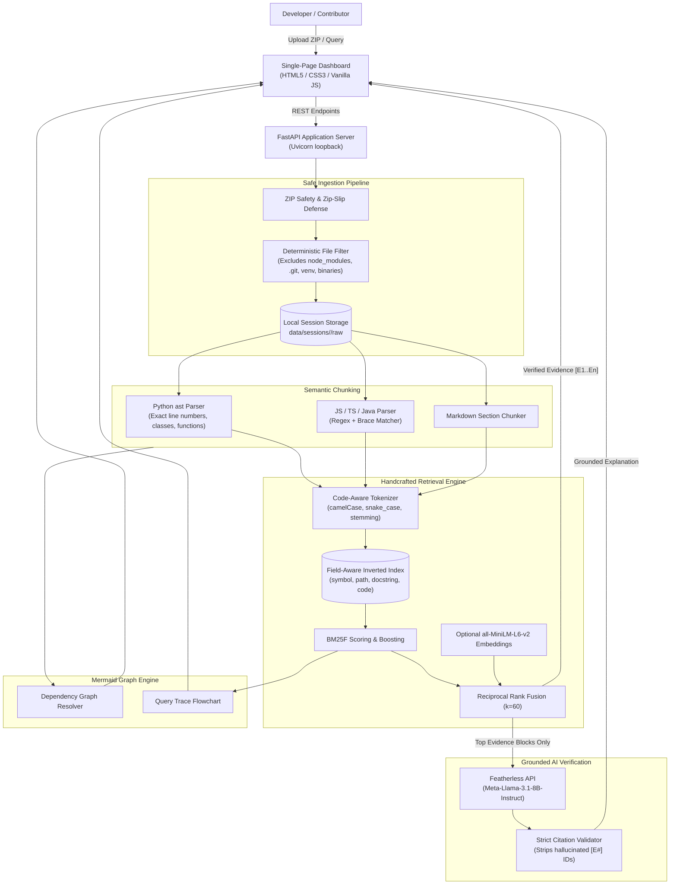
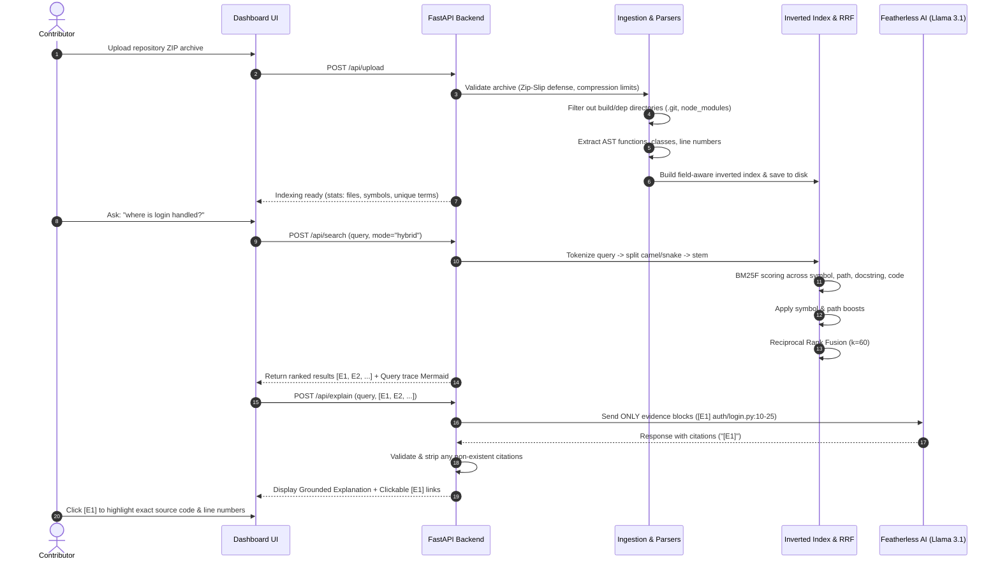

# NextGen Code Explorer — System Architecture

NextGen Code Explorer is a local-first code discovery engine designed to help new open-source contributors find exact files, functions, and lines in unfamiliar repositories with mathematically verifiable ranking and strictly grounded AI explanations.

---

## 1. High-Level System Architecture

---

## 2. End-to-End Workflow Sequence Diagram

---

## 3. Core Architectural Guarantees

1. **Strictly Grounded Explanations**: The AI model is NEVER sent the entire repository. It only receives the top retrieved code snippets formatted as numbered evidence blocks (`[E1]`, `[E2]`). The backend rigorously parses and validates every citation tag (`\[E\d+\]`) against genuine evidence IDs, stripping hallucinated references.
2. **Zero Hallucination Search**: Retrieval is powered by a handcrafted, deterministic, field-aware BM25F inverted index. No black-box AI model decides which files exist or which functions match.
3. **Zip-Slip & Path Traversal Immunity**: Archive extraction enforces strict canonical path containment (`os.path.commonpath`), disallows symbolic links, and validates compression ratios to prevent zip bombs. File context viewing (`/api/file`) enforces containment inside the session directory.
4. **Complete Offline / Search-Only Resilience**: If no Featherless API key is provided, or if the network is disconnected, search functions with 100% fidelity. The UI clearly reports the operational status of the AI and semantic layers.
